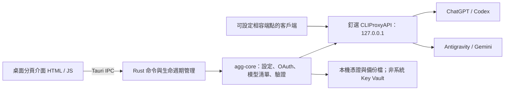

# 🌉 ModelBridge: Universal Local AI Gateway & Model Switcher

<div align="center">

[](LICENSE)
[]()
[]()
[]()

**以本機閘道整合 ChatGPT / Codex 與 Antigravity 帳號，管理 Codex 連線設定與模型清單**

[架構設計](#-架構設計) • [核心特性](#-核心特性) • [支援客戶端與模型](#-支援客戶端與模型) • [快速開始](#-快速開始) • [安全與隱私](#-安全與隱私)

</div>

---

## 📖 簡介 (Overview)

**ModelBridge** 是一套專為現代 AI 工作流打造的高效能本機 AI 聚合閘道與智慧模型調度中樞。

> **目前版本限制：**每種來源暫限一個帳號。新增與重新授權分開：已有憑證時，重新授權會在隔離核心完成，確認同一帳號後才替換原檔；失敗或取消保留原憑證。舊格式無法確認身分時拒絕覆寫。憑證存在、本人確認授權、模型測試通過是不同狀態，均不保證後續持續可用。

模型查詢不執行推論；真實模型測試須先勾選額度同意，會發送兩回合請求。Windows 可在驗證程序、埠號、金鑰及保護紀錄後接管背景閘道；其他平台尚未支援接管。停止閘道保留 `runtime/auth` 憑證，重新啟動不會自動恢復「已驗證」標記。

本工具提供本機 OpenAI 相容介面，實際支援的客戶端功能、模型與額度取決於釘選核心、帳號及上游服務。預設不讀寫 `~/.codex/auth.json`。

---

## 🏗 架構設計 (Architecture)



---

## ✨ 核心特性

- **閘道管理**：啟動、停止、狀態檢查、Windows 背景閘道接管與保守的殘留紀錄復原。
- **帳號管理**：每種類型一個帳號；支援瀏覽器授權、狀態查詢及同帳號重新授權。
- **模型清單**：由帳號憑證查詢，排除 Claude 與圖像模型；來源查詢失敗時保留原模型目錄。
- **Codex 設定**：遮蔽金鑰的差異預覽、備份、套用、暫停及還原；支援自訂模型目錄路徑。
- **桌面介面**：依功能分頁、明暗主題、狀態與錯誤提示。

## 🔌 客戶端與模型範圍

| 項目 | 目前範圍 |
| --- | --- |
| Codex 設定整合 | 管理 `config.toml` 與 `model_catalog.json`；特定客戶端版本仍需實機驗收 |
| 其他 OpenAI 相容客戶端 | 可嘗試介面顯示的本機端點與存取金鑰；不宣稱已逐一驗證 Cursor、Windsurf、Cline 等工具 |
| GPT / Gemini | 以帳號查詢結果為準，清單存在不等於已完成推論測試 |
| Claude、圖像模型、本地 LLM | 不在本版本桌面整合驗收範圍 |

詳細證據與未驗證項目見 [驗證紀錄](docs/VERIFICATION.md)。

---

## 🚀 快速開始 (Quickstart)

### 系統需求
* **macOS** 12.0+ / **Linux** / **Windows** 10+
* **Rust** 1.88 或更高版本（桌面殼需 1.90，因為 Tauri 2.12.5 的 `rust-version` 是 1.90）
* **Git**

### 安裝與啟動

1. **複製倉庫**
   ```bash
   git clone https://github.com/zack-tools/model-bridge.git
   cd model-bridge
   ```

2. **下載本機核心元件**
   ```bash
   ./scripts/fetch-core.sh
   ```

3. **啟動 ModelBridge 桌面控制台**
   ```bash
   ./run-desktop.sh
   ```
   *先啟動閘道、檢查帳號與模型，再預覽並套用 Codex 設定。使用介面顯示的實際埠號；50833 被佔用時會選擇其他埠。*

---

## 🧪 測試與驗證 (Verification)

自動化測試涵蓋核心與模擬協定；不等同於真人 OAuth、真實模型或桌面視覺驗收：

```bash
# 執行工作區核心單元與協議測試
cargo test --workspace

# 執行 Tauri 桌面後端合約測試
cargo test --manifest-path apps/desktop/src-tauri/Cargo.toml

# macOS：在 .handoff 隔離目錄離線檢查 rollback（不需要閘道或 OAuth）
bash scripts/macos-rollback-selftest.sh
```

Apple Silicon 的視窗、OAuth 與 Codex 回合見 [docs/MACOS_ARM64_HANDOFF.md](docs/MACOS_ARM64_HANDOFF.md)。交接腳本必須用 bash 執行，不要在 zsh 裡 source。

---

## 🔒 安全聲明 (Security & Ethics)

* **憑證檔案**：憑證與本機金鑰存於應用程式資料目錄，未整合系統 Key Vault；請依作業系統帳號與目錄權限保護，勿將執行期資料納入 Git。
* **資料流向**：閘道僅繫結 `127.0.0.1`；模型請求仍會傳送至授權上游，不能視為完全離線或零外傳。本機其他程式也可能存取回送端點，需保護金鑰。
* **合法合規**：請依各模型供應商（OpenAI、Google 等）之服務條款使用個人合法授權或 API 額度。

---

## 📄 授權條款 (License)

本專案採用 [MIT License](LICENSE) 授權開源。
