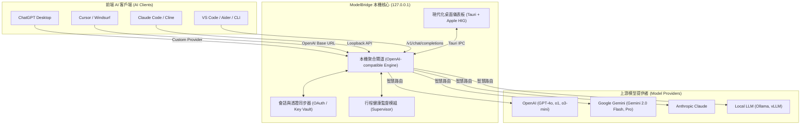

# 🌉 ModelBridge: Universal Local AI Gateway & Model Switcher

<div align="center">

[](LICENSE)
[]()
[]()
[]()

**將任何 AI 編輯器與桌面工具，無縫橋接至任意大語言模型的通用本機調度閘道**

[架構設計](#-架構設計) • [核心特性](#-核心特性) • [支援客戶端與模型](#-支援客戶端與模型) • [快速開始](#-快速開始) • [安全與隱私](#-安全與隱私)

</div>

---

## 📖 簡介 (Overview)

**ModelBridge** 是一套專為現代 AI 工作流打造的高效能本機 AI 聚合閘道與智慧模型調度中樞。

> **目前版本限制：**每種來源暫限一個帳號。同類型已有本機憑證時會拒絕再次授權，以避免新增第二個同類帳號；重新啟動後的安全重新確認尚未支援，既有帳號可能因此無法進行模型查詢。背景閘道重新開啟視窗後目前無法安全接管，需依介面提示人工檢查。模型清單與特定帳號的實際可用性，仍須分別驗證。

以往在不同 AI 編輯器或桌面客戶端（例如 ChatGPT Desktop、Cursor、Windsurf、Claude Code、Cline 等）中，往往受限於單一廠商的封閉生態或固定模型清單。**ModelBridge** 透過在本地建立標準化的 OpenAI 相容通訊閘道，讓您能夠自由在各種工具中切換使用 GPT-4o、o1/o3-mini、Gemini 2.0/1.5 以及開源本地模型。閘道使用自己的 OAuth 登入，預設不讀寫 `~/.codex/auth.json`。

---

## 🏗 架構設計 (Architecture)



---

## ✨ 核心特性 (Key Features)

* **🌐 通用客戶端相容 (Universal Compatibility)**
  * 提供完整的 OpenAI 相容 API 端點（`/v1/models`, `/v1/chat/completions`, `/v1/responses`）。
  * 支援任何能配置 `base_url` 的 AI 編輯器、CLI 程式碼代理與桌面客戶端。
* **⚡️ 支援官方原生 Custom 供應商模式**
  * 完美支援 ChatGPT Desktop / Codex 的 `Custom` 模式切換，保持原生使用者體驗。
  * 提供「⚡️ 一鍵配置 ChatGPT Desktop」，自動完成模型同步與閘道連結。
* **🔐 本機帳號與憑證**
  * 目前提供 ChatGPT / Codex 與 Antigravity 各一個授權位置；暫不支援同類多帳號。
  * 憑證由核心保存在本機檔案，登入狀態不會自動視為已驗證；重新確認的限制如上所述。
* **🛡 100% 本機隱私優先 (Privacy-First Loopback)**
  * 閘道僅監聽 `127.0.0.1` 本地迴路地址，絕對禁止外部未授權連線。
  * 無任何第三方遙測（Telemetry）資料收集，代碼與對話完全保留在您的本機與授權服務商之間。
* **🖥 精緻原生桌面控制台 (Modern Desktop GUI)**
  * 基於 Tauri 2.0 構建的超輕量桌面應用程式，整合 Apple HIG 設計語言。
  * 具備動態健康心跳燈、可用模型即時清單、端點監聽狀態與一鍵日誌複製。

---

## 🔌 支援客戶端與模型

### 已驗證前端客戶端 (Verified Clients)
| 工具類型 | 客戶端名稱 | 設定方式 |
| :--- | :--- | :--- |
| **桌面 App** | ChatGPT Desktop | 供應商選擇 `Custom`，一鍵自動同步 |
| **AI 編輯器** | Cursor | 設定 OpenAI Base URL: `http://127.0.0.1:50833/v1` |
| **AI 編輯器** | Windsurf | 設定自訂模型端點 `http://127.0.0.1:50833/v1` |
| **CLI / 擴充套件** | Claude Code / Cline | API Provider 選 OpenAI 相容端點 |
| **終端代理** | Aider / LangChain / Continue | `OPENAI_API_BASE=http://127.0.0.1:50833/v1` |

### 支援上游模型系列 (Supported Models)
* **OpenAI 系列**：`gpt-4o`, `gpt-4o-mini`, `o1`, `o1-mini`, `o3-mini`, `chatgpt-4o-latest`
* **Google Gemini 系列**：`gemini-2.0-flash`, `gemini-1.5-pro`, `gemini-1.5-flash`
* **本地 / 自訂模型**：Ollama, vLLM, LM Studio

---

## 🚀 快速開始 (Quickstart)

### 系統需求
* **macOS** 12.0+ / **Linux** / **Windows** 10+
* **Rust** 1.88 或更高版本（桌面殼需 1.90，因為 Tauri 2.12.5 的 `rust-version` 是 1.90）
* **Git**

### 安裝與啟動

1. **複製倉庫**
   ```bash
   git clone https://github.com/zack-tools/model-bridge.git
   cd model-bridge
   ```

2. **下載本機核心元件**
   ```bash
   ./scripts/fetch-core.sh
   ```

3. **啟動 ModelBridge 桌面控制台**
   ```bash
   ./run-desktop.sh
   ```
   *控制台開啟後，點擊「⚡️ 一鍵設定 ChatGPT Desktop」或在您的 AI 編輯器填入 `http://127.0.0.1:50833/v1` 即可開始使用！*

---

## 🧪 測試與驗證 (Verification)

本專案具備完整的自動化單元測試與端到端合約整合測試：

```bash
# 執行工作區核心單元與協議測試
cargo test --workspace

# 執行 Tauri 桌面後端合約測試
cargo test --manifest-path apps/desktop/src-tauri/Cargo.toml

# macOS：在 .handoff 隔離目錄離線檢查 rollback（不需要閘道或 OAuth）
bash scripts/macos-rollback-selftest.sh
```

Apple Silicon 的視窗、OAuth 與 Codex 回合見 [docs/MACOS_ARM64_HANDOFF.md](docs/MACOS_ARM64_HANDOFF.md)。交接腳本必須用 bash 執行，不要在 zsh 裡 source。

---

## 🔒 安全聲明 (Security & Ethics)

* **憑證保護**：所有登入 Token 及設定檔皆隔離儲存於作業系統指定之受保護應用程式目錄，絕不納入 Git 版本控制。
* **本機回送**：閘道僅繫結於 `127.0.0.1`，不開放任何公網連接埠。
* **合法合規**：請依各模型供應商（OpenAI、Google 等）之服務條款使用個人合法授權或 API 額度。

---

## 📄 授權條款 (License)

本專案採用 [MIT License](LICENSE) 授權開源。
